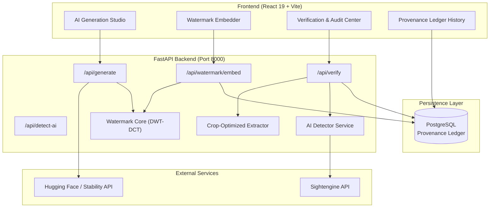

# Content-Provenance Watermarking for AI-Generated Media

[](https://www.python.org/)
[](https://fastapi.tiangolo.com/)
[](https://react.dev/)
[](https://www.typescriptlang.org/)
[](https://vitejs.dev/)
[](https://tailwindcss.com/)
[](#license)

An end-to-end framework for embedding, tracking, and cryptographically verifying the provenance of AI-generated media. The system embeds an imperceptible frequency-domain watermark (DWT-DCT) into generated images, indexes tamper-evident metadata in a PostgreSQL provenance ledger, and provides robust verification capable of surviving cropping, compression, resizing, and adversarial tampering.

---

## Table of Contents

- [Overview](#overview)
- [Key Features](#key-features)
- [System Architecture](#system-architecture)
- [Watermarking & Verification Engine](#watermarking--verification-engine)
- [Project Structure](#project-structure)
- [Getting Started](#getting-started)
  - [Prerequisites](#prerequisites)
  - [Backend Setup](#backend-setup)
  - [Frontend Setup](#frontend-setup)
- [Environment Configuration](#environment-configuration)
- [API Reference](#api-reference)
- [Verification Verdicts](#verification-verdicts)
- [Testing & Diagnostics](#testing--diagnostics)
- [License](#license)

---

## Overview

As generative AI models create increasingly realistic imagery, proving origin and detecting unauthorized modification is critical. This project delivers a complete provenance lifecycle:

1. **Generation**: Text-to-image synthesis using FLUX.1, Stable Diffusion, or mock providers.
2. **Invisible Watermarking**: Blind 192-bit payload injection into the luminance channel using Discrete Wavelet Transform (DWT) and Discrete Cosine Transform (DCT).
3. **Ledger Storage**: Dual-hash logging (SHA-256) and generation metadata tracked in a PostgreSQL database.
4. **Resilient Verification**: Blind extraction with spatial crop-recovery algorithms, geometric invariant search, and probabilistic AI detection (Sightengine / Hugging Face).

---

## Key Features

- **Invisible Frequency-Domain Watermarking**:
  - 1-level 2D Haar DWT applied to the Y (luminance) channel in YCbCr color space.
  - 8×8 block DCT on HL and LH mid-frequency coefficient pairs.
  - Quantization Index Modulation (QIM) with configurable embedding strength ($\Delta$).
  - High fidelity: PSNR > 42 dB and SSIM > 0.99 with imperceptible perceptual degradation.

- **Payload Integrity & Error Correction**:
  - 192-bit payload: 32-bit magic preamble (`0x4350574D`), 128-bit UUID, and 32-bit CRC checksum.
  - 3× repetition coding with pseudorandom permutation interleaving for spatial burst error protection.

- **Crop & Geometric Resilience**:
  - Multi-scale search pyramid and fast sub-window sliding search.
  - Recovers valid watermarks from crops down to 15% of the original image area.
  - Bounding-box and aspect-ratio invariant synchronization.

- **Dual-Verification Verdict Matrix**:
  - Identifies unaltered originals, modified/cropped media, unwatermarked content, or corrupted payloads.

- **Integrated AI Detection**:
  - Multi-layered audit combining cryptographic watermark proof with probabilistic AI-generation detection (via Sightengine or Hugging Face classifier).

- **Modern Interactive Dashboard**:
  - Responsive web interface built with React 19, TypeScript, Vite, Tailwind CSS, and Framer Motion.

---

## System Architecture



---

## Watermarking & Verification Engine

### Watermark Embedding Pipeline
1. **Color Conversion**: Convert RGB input image to YCbCr color space; extract the Y channel.
2. **DWT Decomposition**: 1-level 2D Haar DWT produces LL, LH, HL, and HH subbands.
3. **Payload Construction**:
   - `Preamble (32 bits)` + `UUID (128 bits)` + `CRC-32 (32 bits)` = `192 bits`.
   - Repeated 3× (576 bits) and permuted with a reproducible PRNG seed.
4. **8×8 Block DCT**: HL and LH subbands are divided into 8×8 blocks.
5. **QIM Coefficient Modulation**: Mid-frequency DCT coefficients are quantised according to payload bits and step size $\Delta$.
6. **Inverse Transforms**: Inverse 8×8 DCT, followed by 2D Inverse DWT and YCbCr $\rightarrow$ RGB conversion.
7. **Lossless Output**: Saved as PNG to prevent lossy compression artefacts from destroying coefficients.

### Verification Matrix

| Verdict | Watermark Extracted? | Hash Matches DB? | Explanation |
| :--- | :---: | :---: | :--- |
| **`AUTHENTIC_UNMODIFIED`** | Yes (Valid UUID + CRC) | Yes | Byte-for-byte authentic image matching registered record. |
| **`TRACED_BUT_MODIFIED`** | Yes (Valid UUID + CRC) | No | Watermark provenance intact, but media was cropped, compressed, or edited. |
| **`NO_WATERMARK_FOUND`** | No | N/A | Image does not contain the expected watermark payload. |
| **`WATERMARK_UNRECOVERABLE`** | Corrupted | N/A | Trace signatures detected, but payload failed CRC error check. |

---

## Project Structure

```text
├── backend/                        # FastAPI backend application
│   ├── alembic/                    # Database migrations
│   ├── app/
│   │   ├── api/routes/             # Endpoint routers (generate, watermark, verify, detect)
│   │   ├── core/                   # App configuration & settings
│   │   ├── models/                 # SQLAlchemy models (provenance, asset, verification)
│   │   └── services/               # Provenance, verification, and AI detection services
│   ├── tests/                      # Pytest suite & integration tests
│   ├── .env.example                # Example backend environment variables
│   └── requirements.txt            # Python dependencies
│
├── frontend/                       # React + TypeScript + Vite frontend
│   ├── src/
│   │   ├── api/                    # Axios API client & type definitions
│   │   ├── components/             # Reusable UI components & layouts
│   │   ├── pages/                  # Dashboard, Generate, Protect, Verify, History pages
│   │   └── App.tsx                 # Application router
│   ├── package.json                # Frontend package configuration
│   └── vite.config.ts              # Vite config with backend proxy
│
├── watermark/                      # Core DWT-DCT watermarking library
│   ├── blocks.py                   # 8x8 block partitioning
│   ├── dct.py                      # Discrete Cosine Transform utilities
│   ├── dwt.py                      # Discrete Wavelet Transform decomposition
│   ├── ecc.py                      # Error correction & repetition coding
│   ├── embed.py                    # Watermark embedding pipeline
│   ├── extract.py                  # Blind watermark extraction
│   ├── extract_crop_optimized.py   # Crop & scale-resilient fast extractor
│   ├── payload.py                  # 192-bit payload framing (preamble, UUID, CRC)
│   └── preprocess.py               # Aspect ratio & padding utilities
│
├── docs/                           # Implementation logs & architectural documentation
├── scripts/                        # Benchmarking & synchronization scripts
└── setup.py                        # Python package setup for `watermark`
```

---

## Getting Started

### Prerequisites

- **Python**: 3.10 or higher
- **Node.js**: v18 or higher (with npm)
- **PostgreSQL**: 14 or higher running locally or in Docker

---

### Backend Setup

1. **Activate or create a Python virtual environment**:
   ```bash
   cd backend
   python -m venv .venv
   # Windows:
   .venv\Scripts\activate
   # Linux/macOS:
   source .venv/bin/activate
   ```

2. **Install dependencies**:
   ```bash
   pip install -r requirements.txt
   # Install the watermark module in editable mode from the repository root:
   pip install -e ..
   ```

3. **Configure Environment Variables**:
   Copy `.env.example` to `.env` and fill in your database credentials and optional API keys:
   ```bash
   cp .env.example .env
   ```

4. **Run Database Migrations**:
   ```bash
   alembic upgrade head
   ```

5. **Start the FastAPI server**:
   ```bash
   uvicorn app.main:app --reload --port 8000
   ```
   The backend API will be running at `http://localhost:8000`.
   Interactive OpenAPI docs are available at `http://localhost:8000/docs`.

---

### Frontend Setup

1. **Navigate to the frontend directory**:
   ```bash
   cd frontend
   ```

2. **Install npm dependencies**:
   ```bash
   npm install
   ```

3. **Start the development server**:
   ```bash
   npm run dev
   ```
   The frontend will be accessible at `http://localhost:5173`.
   Vite is configured to proxy all `/api/*` calls to `http://localhost:8000`.

---

## Environment Configuration

Configure the following variables in `backend/.env`:

| Variable | Default | Description |
| :--- | :--- | :--- |
| `DATABASE_URL` | `postgresql+psycopg2://...` | Connection string for PostgreSQL |
| `APP_ENV` | `development` | Environment mode (`development` / `production`) |
| `LOG_LEVEL` | `INFO` | Application log verbosity |
| `AI_PROVIDER` | `mock` | Generation provider: `mock`, `stability`, `huggingface` |
| `AI_API_KEY` | `""` | API key for AI generation provider |
| `AI_MODEL` | `FLUX.1-schnell` | Model identifier for generation |
| `AI_DETECTOR_PROVIDER` | `mock` | AI detector: `mock`, `sightengine`, `huggingface` |
| `SIGHTENGINE_API_USER` | `""` | User ID for Sightengine API |
| `SIGHTENGINE_API_SECRET` | `""` | API secret for Sightengine API |
| `AI_DETECTOR_THRESHOLD` | `0.70` | Threshold for classifying an image as AI-generated |

---

## API Reference

| Method | Endpoint | Description | Request | Response |
| :--- | :--- | :--- | :--- | :--- |
| `GET` | `/health` | Health check & database connectivity | None | JSON status |
| `POST` | `/generate` | Generate AI image from text prompt | JSON: `{"prompt": "..."}` | PNG Image Bytes + Headers |
| `POST` | `/watermark/embed` | Inject DWT-DCT watermark & register in DB | Multipart: `file` | Watermarked PNG |
| `POST` | `/verify` | Extract watermark & verify provenance | Multipart: `file` | JSON Verification Report |
| `POST` | `/detect-ai` | Probabilistic AI vs Human image detection | Multipart: `file` | JSON Detection Confidence |

---

## Testing & Diagnostics

### Run Backend Unit & Integration Tests
```bash
cd backend
pytest
```

### Run Robustness Benchmarks
Test watermark survival against JPEG compression, noise injection, and severe cropping:
```bash
python scripts/robustness_benchmark.py
python backend/robustness_test.py
```

### Run Crop Resilience Tests
```bash
python test_crops.py
python test_15_crop_optimized.py
```

---

## License

This project is developed for research and educational purposes in multimedia security and content provenance. Licensed under the academic and open-source terms specified in the repository.
